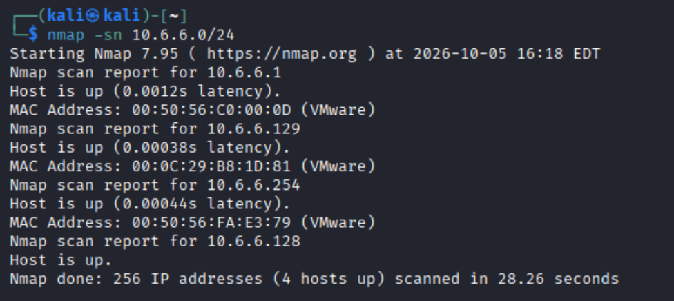
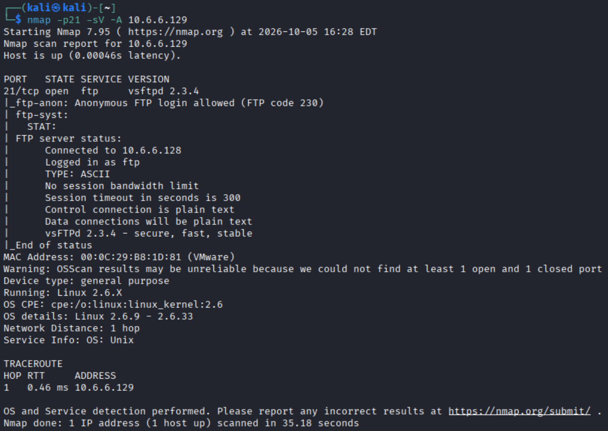
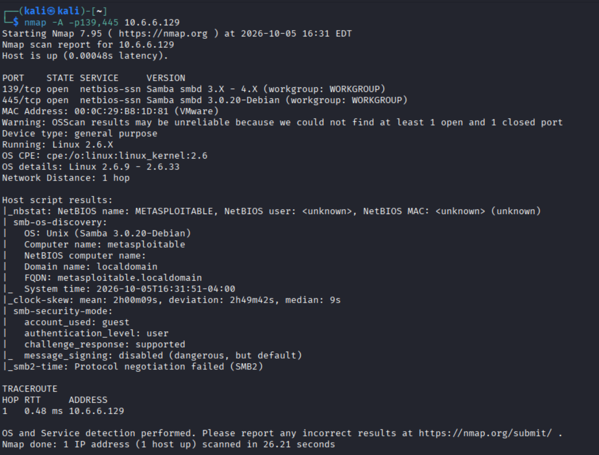

# Network Reconnaissance with Nmap

## Overview

This project documents a hands-on network reconnaissance and enumeration exercise performed in an isolated virtual lab environment.

The objective was to identify active hosts, discover exposed ports and services, and analyze the attack surface of an intentionally vulnerable Metasploitable machine using Nmap.

## Lab Environment

- **Attacker machine:** Kali Linux
- **Target machine:** Metasploitable
- **Virtualization:** VMware
- **Network:** Isolated private lab network
- **Tool:** Nmap

> All testing was performed against intentionally vulnerable systems in a controlled lab environment.

## Objectives

- Discover active hosts on the network
- Identify open TCP ports
- Detect running services and versions
- Perform operating system reconnaissance
- Identify exposed SMB services
- Understand how network enumeration contributes to attack surface discovery

## Host Discovery

The first phase consisted of identifying active hosts within the lab subnet.

```bash
nmap -sn 10.6.6.0/24
```



*Host discovery identified four active systems within the isolated lab network.*

The results provided an initial view of the network and allowed the Metasploitable machine to be selected for further enumeration.

## FTP Service Enumeration

After identifying the target, a focused scan was performed against the FTP service to determine its version and configuration.

```bash
nmap -p21 -sV -A 10.6.6.129
```



The scan identified **vsftpd 2.3.4** running on port 21 and revealed that **anonymous FTP login was enabled**.

This demonstrates how service enumeration can reveal both software versions and potentially insecure configurations.

## SMB Reconnaissance

SMB-related services were then investigated through ports 139 and 445.

```bash
nmap -A -p139,445 10.6.6.129
```



The scan revealed information including:

- SMB services on ports **139/tcp** and **445/tcp**
- Samba **3.0.20-Debian**
- NetBIOS hostname **METASPLOITABLE**
- Workgroup **WORKGROUP**
- SMB message signing disabled

These findings provided useful information for a more detailed SMB enumeration phase.

## Key Findings

The reconnaissance phase revealed:

- Multiple exposed network services
- Anonymous FTP access enabled
- SMB services exposed through ports 139 and 445
- Service and version information useful for vulnerability analysis
- Additional system and SMB configuration information

## Security Perspective

Network reconnaissance is an important early phase of a penetration test.

Information such as exposed ports, service versions, operating systems, and insecure configurations can help identify potential attack vectors and determine which services require deeper security testing.

## Next Step

The next project focuses on **SMB enumeration using enum4linux and smbclient**.
